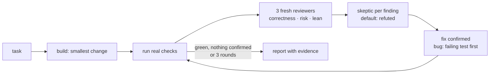

# braid

**Code autopilot for Claude Code.** You give a task; braid does it with the smallest change, then runs your project's real checks, gets a fresh-eyes review, tries to refute every finding, fixes what is real (bugs get a failing test first) and repeats until clean. You read the result.

[Русская версия](README.ru.md)



Why it is built this way:

- **Checks decide, not the model.** Tests, type checkers, linters and Godot's own compiler are ground truth. "Should work" is not evidence.
- **Fresh eyes.** Reviewers are subagents that never saw how the code was written.
- **Most review findings are wrong.** Every finding goes to a skeptic that tries to disprove it, so noise doesn't turn into needless edits.
- **Bounded.** At most 3 rounds. Repeated fixes of the same thing stop and get reported as "needs redesign" instead of churning.
- **Lean.** The build step follows the [ponytail](https://github.com/DietrichGebert/ponytail) ladder: skip what isn't needed, reuse, standard library, one line, then the minimum code.

## Install

```
/plugin marketplace add HighVoltSound/braid
/plugin install braid@braid
```

Requires Node.js 18+ on PATH (the hooks and the check runner are Node scripts).

Recommended companion: `/plugin marketplace add DietrichGebert/ponytail` and `/plugin install ponytail@ponytail`. braid works without it.

## Use

| Command | What it does |
|---|---|
| `/braid:braid add a pause menu` | Builds the task, then runs the loop |
| `/braid:braid` | Loops over your current changes (`git diff HEAD` plus untracked files) |
| `/braid:braid src/cart.js` | Loops over the named files or folder |
| `/braid:braid audit` | Loops over the whole project |

The report lists every check with PASS or FAIL from a fresh run, what was fixed (with `path:line`), the decisions it made instead of asking you, and what no check covers.

## Checks it finds by itself

| Stack | Checks |
|---|---|
| JavaScript / TypeScript | `typecheck`, `lint`, `test`, `build` scripts (npm, pnpm, yarn, bun); `tsc --noEmit` |
| Deno | `deno lint`, `deno check`, `deno test` |
| Python | `ruff`, `mypy`, `pytest` (through `uv run` or `poetry run` when locked) |
| Rust · Go · .NET | `cargo clippy`, `cargo test` · `go vet`, `go test` · `dotnet test` |
| Java / Kotlin · Swift · Dart / Flutter | Gradle or Maven `test` · `swift test` · `analyze`, `test` |
| Elixir · Ruby · PHP · Make | `mix test` · `rspec` or `rake test` · `composer test` or `phpunit` · `make test` |
| Godot 4 | headless import, compile of every script and scene, `tests/*.gd` that `extends SceneTree`, GUT, gdUnit4, `gdlint` |

Anything else: one line in `.claude/braid.json`:

```json
{ "checks": { "test": "ctest --test-dir build", "lint": "clang-tidy src/*.cpp" } }
```

Run them yourself with `node <plugin>/scripts/checks.js [dir] [--list] [--fast]`.

## The stop gate

braid also adds a Stop hook. When Claude changed source files during a turn and is about to finish, it runs the fast checks (types, lint, compile; no tests or builds) and refuses to stop while they fail. It shows Claude the errors, and lets go if:

- the code did not change during this turn, or matches the last green run (your own edits between turns never count);
- Claude stops again without editing (for example, the failure was already there before);
- it already blocked 3 times this turn;
- the check commands themselves changed during the turn (it will not run new commands unasked; run `/braid:braid` instead).

A missing Godot binary never blocks. The gate gives up rather than run past the hook's time limit.

It also works when the session is opened in a folder of projects (such as `GODOT_PROJECTS/`), checking each changed project inside.

Turn it off with `{"gate": "off"}` in `.claude/braid.json` or `BRAID_GATE=off`. Use `"all"` to also run tests on every stop.

**Trust:** the gate runs whatever check commands the checkout defines (`npm run lint` and the config it loads, `.claude/braid.json` entries, Godot import, which runs the project's editor plugins). That is the same trust you give a project's `.claude/settings.json` hooks. Use it on code you trust. State is kept per user in `~/.cache/braid`.

## Godot notes

- Godot 4 projects only (`config_version=5`). For Godot 3, put your checks in `.claude/braid.json`.
- The Godot binary is found by itself: `GODOT_BIN`, PATH, or portable downloads in `Downloads`, `Desktop`, `Documents`, `Program Files`. Among downloads, the build matching the project's `config/features` version wins, and C# projects get a .NET (mono) build. On Windows the `_console.exe` twin is used because it reports exit codes reliably. Or set `"godot": "C:/path/Godot.exe"` in `.claude/braid.json`.
- `--import` writes `*.gd.uid` files next to scripts. That is normal Godot 4.4+ behavior; commit them.
- Folders with a `.gdignore` file are skipped, as Godot does.
- Godot exits 0 on most script errors, so braid reads its output: `SCRIPT ERROR`, parse errors and `ERROR:` lines (including `push_error`) fail a check; shutdown noise does not.
- Warnings set to level 1 are invisible headless. To make braid see them, set the ones you care about to 2 (error) in `project.godot`, e.g. `gdscript/warnings/untyped_declaration=2`.
- Test convention: `tests/<name>_test.gd` that `extends SceneTree`. Assert in `_initialize()` after `await process_frame` (so autoloads exist), `load()` project scripts, reach autoloads with `root.get_node("Name")`, and end with `quit(0)` or `quit(1)`.

## Settings

| Where | Key | Meaning |
|---|---|---|
| `.claude/braid.json` | `checks` | Map of name to command. Replaces detection. |
| `.claude/braid.json` | `godot` | Path to the Godot binary. |
| `.claude/braid.json` | `gate` | `fast` (default), `all` or `off`. |
| env | `GODOT_BIN` | Path to the Godot binary. |
| env | `BRAID_GATE` | Overrides `gate`. |
| env | `BRAID_TIMEOUT` | Seconds per check, default 600 (120 inside the stop gate). |

## Tested

Before release, `claude -p "/braid:braid audit"` ran on three small projects (JavaScript, Python, Godot 4.7) with planted bugs, dead code and traps: code that looks unused but is called by name or wired to a signal in a `.tscn`. Hidden tests the agent never saw graded the result. On the final run:

| Project | Planted bugs fixed | Traps kept | Dead code removed | Checks |
|---|---|---|---|---|
| JavaScript | 2/2 (+3 real bugs it found on its own) | yes | yes | green |
| Python | 2/2 | yes | kept, as a recorded ruling (public name in an installable package) | green |
| Godot 4.7 | 2/2, each with a failing test first | yes | yes | green |

Each run took 2-4 minutes. In task mode ("add a remove command") it made a one-line change with a test, and it reported an out-of-scope bug instead of touching it. A live session confirmed the stop gate blocks a broken GDScript edit.

## Limits

braid can only be as sure as your checks. It writes a test for every bug it fixes, so coverage grows with each run, but it cannot see what nothing measures: how a game feels, visuals, performance on a real device. It says so in every report.

## Credits

- Build ladder adapted from [ponytail](https://github.com/DietrichGebert/ponytail) by Dietrich Gebert (MIT).
- Verification-before-completion and test-first fixing ideas from [superpowers](https://github.com/obra/superpowers) (MIT).
- Refuting each finding before acting on it follows Anthropic's [code-review plugin](https://github.com/anthropics/claude-code/tree/main/plugins/code-review) and [Claude Code best practices](https://code.claude.com/docs/en/best-practices).

## Development

```
npm test
```

Runs the unit tests and, when a Godot binary is found, integration tests against real generated Godot projects.

MIT License.
