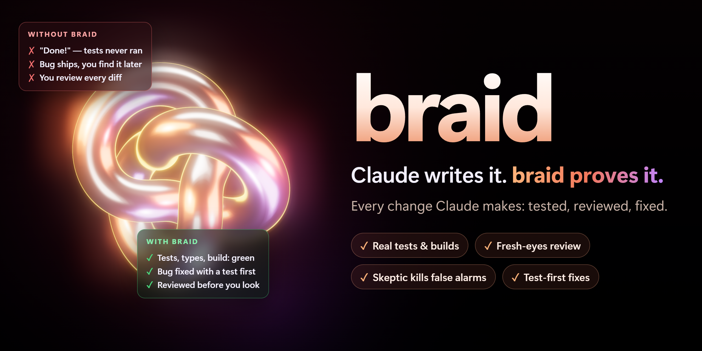
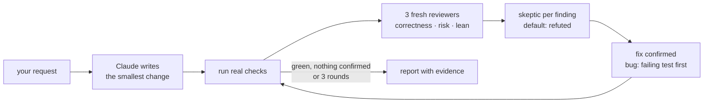

<p align="center"></p>

<p align="center">
  <a href="https://github.com/HighVoltSound/braid/actions/workflows/test.yml"></a>
  <a href="https://github.com/HighVoltSound/braid/releases"></a>
  <a href="LICENSE"></a>
  <a href="https://nodejs.org/">=20"></a>
  <a href="https://code.claude.com/docs/en/plugins"></a>
  <a href="#godot-notes"></a>
</p>

<p align="center">
  <a href="#install-in-30-seconds">Install</a> ·
  <a href="#how-it-works">How it works</a> ·
  <a href="#for-teams">For teams</a> ·
  <a href="#settings">Settings</a> ·
  <a href="#faq--troubleshooting">FAQ</a>
</p>

# braid

**After every turn in which Claude changes code, braid runs your real checks, reviews the change with fresh eyes and fixes what is really broken, before Claude hands the turn back.**

- **Real tests and builds decide.** Your type checker, linter, tests and the engine's own compiler run on the change. "Should work" is not evidence.
- **Three fresh-eyes reviewers.** Subagents that never saw the code being written review it for correctness, risk and bloat.
- **A skeptic refutes every finding.** Each finding must survive an attempt to disprove it, so false alarms never turn into edits.
- **Bugs get a failing test first.** Each bug fix starts with a test that fails because of the bug, then every check runs again. Where no test can reach it, the report says so.
- **Fully automatic, any stack.** Nothing to type. Checks for JS/TS, Python, Rust, Go, .NET and more are found on their own; Godot, Unreal Engine and Unity are built in.

## Install in 30 seconds

In Claude Code:

```
/plugin marketplace add HighVoltSound/braid
/plugin install braid@braid
```

On recent Claude Code versions (2.1.292+) one shell command does both:

```
claude plugin install braid --marketplace HighVoltSound/braid
```

Then start a new session.

**Requirements: Node.js 20+ on PATH. Nothing else.** braid is plain Node scripts with zero dependencies: no `npm install`, no Python, no build step. Language tools (pytest, Gradle, an engine) are only used when your project already has them.

### Works best with Ponytail

[Ponytail](https://github.com/DietrichGebert/ponytail) by Dietrich Gebert makes Claude write the smallest code that solves the task. braid is the other half: it proves the code works and fixes what doesn't.

```
/plugin marketplace add DietrichGebert/ponytail
/plugin install ponytail@ponytail
```

braid works without it: when Ponytail is not enabled, braid gives Claude a short version of the same ladder at session start. When Ponytail is enabled, braid does not repeat it.

## How it works



**Automatic (default).** At the end of every turn in which Claude changed code, braid's stop hook:

1. Runs the fast checks: types, lint, compile. Godot: headless import and a compile of every script and scene. Unreal: the incremental C++ build. Unity: its C# projects built with `dotnet`. While they fail, Claude may not finish.
2. Then asks Claude, once per turn, to run the review loop on exactly the files this turn changed. braid works out the list itself, with or without git. Your own edits between turns never count.
3. Lets Claude skip the loop, with one line saying why, when its edits only touch comments or formatting, when the changed files are not its edits, or when it must wait for your answer.

**Bounded.** At most 3 rounds and one loop per turn. A finding that comes back after its fix stops and is reported as "needs redesign" instead of churning. After round 1, only must-fix findings keep the loop going.

**By hand,** any time:

| Command | What it does |
|---|---|
| `/braid:braid add a pause menu` | Builds the task, then runs the loop |
| `/braid:braid` | Loops over your current changes (`git diff HEAD` plus untracked files) |
| `/braid:braid src/cart.js` | Loops over the named files or folder |
| `/braid:braid audit` | Loops over the whole project |

The report lists every check as PASS, FAIL or SKIP from a fresh run, what was fixed (with `path:line`), the decisions it made instead of asking you, and what no check covers.

The stop hook lets Claude go when:

- the code did not change this turn, or matches the last green or reviewed run;
- Claude stops again without editing (for example, a failure that was already there);
- it has blocked 3 times this turn;
- the check commands themselves changed during the turn (it never runs new commands unasked);
- an engine is missing (Godot, Unreal, Unity), or the hook is about to pass its time limit.

It also works when the session is opened in a folder of projects (such as `projects/`), handling each changed project inside.

## Checks it finds by itself

| Stack | Checks |
|---|---|
| JavaScript / TypeScript | `typecheck`, `lint`, `test`, `build` scripts (npm, pnpm, yarn, bun); `tsc --noEmit` |
| Deno | `deno lint`, `deno check`, `deno test` |
| Python | `ruff`, `mypy`, `pytest` (through `uv run` or `poetry run` when locked) |
| Rust · Go · .NET | `cargo clippy`, `cargo test` · `go vet`, `go test` · `dotnet test` |
| Java / Kotlin · Swift · Dart / Flutter | Gradle or Maven `test` · `swift test` · `analyze`, `test` |
| Elixir · Ruby · PHP · Make | `mix test` · `rspec` or `rake test` · `composer test` or `phpunit` · `make test` |
| Godot 4 | headless import, compile of every script and scene, `tests/*.gd` that `extends SceneTree`, GUT, gdUnit4, `gdlint` |
| Unreal Engine | C++ build with UnrealBuildTool, Automation tests, compile of the project's Blueprints |
| Unity | compile and EditMode/PlayMode tests in batch mode (embedded packages too), the IDE's generated solution built with `dotnet` (fast) |

Anything else takes one line in `.claude/braid.json`:

```json
{ "checks": { "test": "ctest --test-dir build", "lint": "clang-tidy src/*.cpp" } }
```

Run them yourself with `node <plugin>/scripts/checks.js [dir] [--list] [--fast]`.

## Godot notes

- Godot 4 projects only (`config_version=5`). For Godot 3, put your checks in `.claude/braid.json`.
- The binary is found by itself: `GODOT_BIN`, PATH, or portable downloads in `Downloads`, `Desktop`, `Documents`, `Program Files`. The build matching the project's `config/features` version wins, and C# projects get a .NET build. On Windows the `_console.exe` twin is used for reliable exit codes. Or set `"godot"` in `.claude/braid.json`.
- `--import` writes `*.gd.uid` files next to scripts. That is normal Godot 4.4+ behavior; commit them.
- Folders with a `.gdignore` file are skipped, as Godot does.
- Godot exits 0 on most script errors, so braid reads its output: `SCRIPT ERROR`, parse errors and `ERROR:` lines (including `push_error`) fail a check; shutdown noise does not.
- Warnings at level 1 are invisible headless. Set the ones you care about to 2 (error) in `project.godot`, e.g. `gdscript/warnings/untyped_declaration=2`.
- Test convention: `tests/<name>_test.gd` that `extends SceneTree`. Assert in `_initialize()` after `await process_frame` (so autoloads exist), `load()` project scripts, reach autoloads with `root.get_node("Name")`, end with `quit(0)` or `quit(1)`.

## Unreal Engine notes

- The engine is the exact version in the `.uproject`'s `EngineAssociation`: the launcher install, a source build (its GUID in the registry or `Install.ini`), or `UE_ROOT` / `"unrealEngine"` in `.claude/braid.json`. **braid never opens a project with another engine version** (the engine would convert it silently). It reports SKIP instead.
- Checks, in order:
  - `unreal-build`: `Build.bat <Project>Editor Win64 Development`. A no-op build takes about a second and a `.cpp` edit about 10 s, so it runs in the stop hook too.
  - `unreal-tests`: `UnrealEditor-Cmd -ExecCmds="Automation RunTests StartsWith:<Project>"`, about 15 s, after a passing build.
  - `unreal-blueprints`: `-run=CompileAllBlueprints` over the project's own assets, about 8 s on a small project. It writes its asset list to `Saved/BraidBPAllow.txt`. On a project with thousands of Blueprints, add `"skip": ["unreal-blueprints"]` if it is too slow.
- An open editor with Live Coding (the default) owns the build: the build check reports SKIP and says to press Ctrl+Alt+F11 in the editor. Tests are skipped too, since they would run the old DLL.
- UnrealBuildTool refuses paths of 260+ characters whatever the Windows setting, which leaves about 124 characters for the project folder. Longer paths SKIP with that explanation.
- Compiler messages come in the system language, so braid relies on error codes (`error C2065`, `LNK1104`) and Unreal's own result lines.
- Test convention: `IMPLEMENT_SIMPLE_AUTOMATION_TEST(FNameTest, "Project.Area.Name", EAutomationTestFlags::EditorContext | EAutomationTestFlags::ProductFilter)` in `Source/<Module>/Private/Tests/`.

## Unity notes

- The editor is the exact `m_EditorVersion` from `ProjectSettings/ProjectVersion.txt`, from Unity Hub's install folder or `UNITY_BIN` / `"unity"` in `.claude/braid.json`. **braid never opens a project with another Unity version** (that upgrades it). It reports SKIP instead.
- **Batch mode needs a valid license.** If Unity says "No valid Unity Editor license found", open Unity Hub and sign in; a Personal license expires offline after a while. Until then braid reports SKIP with that hint.
- Checks: `unity-tests` / `unity-playmode` when test assemblies exist in `Assets/` or an embedded package (`-runTests`), else `unity-compile` (`-batchmode -quit`). Then `unity-scripts`: the solution your IDE integration generated, built with `dotnet` in a few seconds. That is also the stop hook's compile check, and the only one while the editor has the project open.
- A failure shows each compile error once, or the failed tests with their messages, instead of Unity's whole log.
- Unity rewrites its generated C# projects only when it refreshes. While they lag behind the code (scripts added, moved or removed, an asmdef or package changed), `unity-scripts` cannot vouch for it: a pass and missing-reference errors SKIP, and any other compiler error still fails. A braid run whose Unity check compiles the project brings them up to date. Those `*.csproj` files do not count as code changes.
- Only one Unity can open a project. While the editor has it open, the batch checks SKIP and `unity-scripts` still runs.
- Test convention: an EditMode test assembly in `Assets/Tests/Editor/` (asmdef with `includePlatforms: ["Editor"]`, `defineConstraints: ["UNITY_INCLUDE_TESTS"]`, `precompiledReferences: ["nunit.framework.dll"]`) that references your code's own asmdef.

## SKIP

A check that cannot run for a reason outside the code (an open editor, Live Coding, a license, a missing engine, a path that is too long) reports `SKIP <name>: <what it needs>`. It never blocks Claude and never counts as a pass: the report lists it under "Not checked".

## For teams

### Cost per turn

One automatic loop is several subagent calls. In testing it took 2-4 minutes and about $0.25-2 of usage per turn that changes code; most real turns cost $0.60-0.72. Turns that change no code cost nothing extra: the hook only compares file sizes and times.

Pick the gate mode that fits the budget:

| Mode | What runs after a turn that changes code |
|---|---|
| `auto` (default) | fast checks, then the review loop |
| `fast` | fast checks only; Claude must fix what fails. No reviewers. |
| `all` | all checks, tests included; no review loop |
| `off` | nothing |

Set it per user with the plugin's `gate` setting (`/plugin configure braid`), per project in `.claude/braid.json`, per shell with `BRAID_GATE`, or for the whole organization in `managed-settings.json`:

```json
{ "env": { "BRAID_GATE": "fast" } }
```

To block braid org-wide, disable it in managed settings, which wins over every other scope:

```json
{ "enabledPlugins": { "braid@braid": false } }
```

Or allow only approved marketplaces with `strictKnownMarketplaces`, so `HighVoltSound/braid` cannot be added at all.

### What the hook executes

braid registers three hooks, all `node hooks/gate.js`:

- **SessionStart** and **UserPromptSubmit**: record which code files exist, with their sizes and modification times (via `git ls-files` when available). They run no project commands. Session start also adds the lean-coding ladder to Claude's context, unless Ponytail is enabled or the gate is off.
- **Stop**: when code changed during the turn, runs the project's fast checks, then asks Claude for the review loop. Each check gets 120 s by default, the whole gate 240 s, and any error inside the hook lets Claude stop (it fails open).

**Trust model.** The checks are commands the checkout defines: `npm run lint` and the config it loads, `.claude/braid.json` entries, a Godot import (which runs the project's editor plugins), an Unreal build (its `*.Build.cs` files), Unity batch mode (its editor scripts), `dotnet build` (Unity's generated `.sln`/`.csproj` and any `Directory.Build.*`). That is the same trust you give a project's own `.claude/settings.json` hooks or `npm test`. If those commands change during a turn, the hook does not run them and says so. Use braid on code you trust.

### CI

When `CI` or `GITHUB_ACTIONS` is set, the hooks do nothing, so `claude -p` in a pipeline is never blocked or slowed by braid. Set `BRAID_GATE` (for example `BRAID_GATE=fast`) to turn it on there.

### No telemetry, no network

braid sends nothing anywhere and makes no network calls of its own. It has no npm dependencies. The checks it runs are your project's tools; they may use the network as they always do (a package manager, Unity licensing). The reviewers and the skeptic are ordinary Claude Code subagents in your session.

### Where state lives

Per user, outside your projects: `$BRAID_CACHE_DIR`, else `$XDG_CACHE_HOME/braid`, else `~/.cache/braid`. Each project gets a few small JSON files named by a hash of its path: the fingerprint of the last green and last reviewed code, per-session baselines (file names, sizes and modification times, never contents) and, for Unity, the last sync record. Snapshots older than 7 days and other state older than 30 days are removed. Unity test results are kept there too. Writes are atomic, so parallel sessions never read a half-written file. Deleting the cache folder is safe; braid starts fresh.

## Settings

| Where | Key | Meaning |
|---|---|---|
| env | `BRAID_GATE` | `auto`, `fast`, `all` or `off` (see [Cost per turn](#cost-per-turn)). Any other value prints a one-line warning and acts as `auto`. Also turns braid on in CI. |
| plugin setting | `gate` | Same values, for every project of this user. Set it with `/plugin configure braid`. |
| `.claude/braid.json` | `gate` | Same values, for one project. |
| `.claude/braid.json` | `checks` | Map of name to command. Replaces detection. On Windows, start a script that sits in the project folder with `.\` (for example `.\lint.cmd`): braid does not run programs from the current folder by bare name. |
| `.claude/braid.json` | `skip` | Check names not to run, e.g. `["unreal-blueprints"]`. |
| `.claude/braid.json` | `godot` · `unrealEngine` · `unity` | Path to the Godot binary, the Unreal Engine root (the folder that holds `Engine/`), the Unity editor binary. |
| env | `GODOT_BIN` · `UE_ROOT` · `UNITY_BIN` | The same paths, for every project. |
| env | `BRAID_TIMEOUT` | Seconds per check, default 600 (120 inside the stop hook). |
| env | `BRAID_CACHE_DIR` | Where state lives (an absolute path; a relative one is ignored). Default `$XDG_CACHE_HOME/braid`, else `~/.cache/braid`. |

The gate mode comes from the first of: `BRAID_GATE`, the plugin setting, `.claude/braid.json`, then `auto`.

## Uninstall

```
/plugin uninstall braid@braid
/plugin marketplace remove braid
```

Then delete the cache folder (`~/.cache/braid`, or your `BRAID_CACHE_DIR`). In Unreal projects you can also delete `Saved/BraidBPAllow.txt`.

## FAQ / Troubleshooting

**How do I know it's running?** `/plugin` shows braid as enabled and `/hooks` lists its SessionStart, UserPromptSubmit and Stop hooks. After a turn that changes code you see "braid: checking the code...", then Claude runs the loop and ends with a report of PASS/FAIL per check. `node <plugin>/scripts/checks.js . --list` shows which checks braid found.

**How do I turn it off for one project or one session?** One project: `{"gate": "off"}` in `.claude/braid.json` (a plugin setting or `BRAID_GATE` overrides it), or `{"enabledPlugins": {"braid@braid": false}}` in that project's `.claude/settings.local.json`. One session: start Claude Code with `BRAID_GATE=off` (PowerShell: `$env:BRAID_GATE="off"; claude`).

**How is this different from `/code-review`?** `/code-review` is a review you ask for. braid is a loop that runs on its own after every turn that changes code: your real checks first, three reviewers, a skeptic against every finding, a failing test before each bug fix, then the checks again until green or 3 rounds.

**What does it cost in tokens?** See [Cost per turn](#cost-per-turn). Switch to `fast` to keep the checks and drop the reviewers, and run `/braid:braid` by hand when you want the full loop.

**The hook never fires.** Check `node --version` prints v20 or later in the shell Claude Code starts from; on Windows, restart Claude Code after installing Node so it sees the new PATH. Start a new session after installing braid. If `CI` or `GITHUB_ACTIONS` is set in your shell, braid stays silent unless `BRAID_GATE` is set too.

**Which files does braid write into my projects?** The tests it adds for the bugs it fixes, which you review like any change. Beyond that, only what the engines write when their checks run:

- Godot: `--import` refreshes `.godot/` and writes `*.uid` files next to scripts (Godot 4.4+).
- Unreal: `Saved/BraidBPAllow.txt`, the asset list for the Blueprint compile, plus the usual build output.
- Unity: batch mode updates `Library/` and the generated `*.csproj` files, as the editor does.

Its own state lives outside the project (see [Where state lives](#where-state-lives)).

## Tested

Before release, `claude -p "/braid:braid audit"` ran on three small projects (JavaScript, Python, Godot 4.7) with planted bugs, dead code and traps: code that looks unused but is called by name or wired to a signal in a `.tscn`. Hidden tests the agent never saw graded the result. On the final run:

| Project | Planted bugs fixed | Traps kept | Dead code removed | Checks |
|---|---|---|---|---|
| JavaScript | 2/2 (+3 real bugs it found on its own) | yes | yes | green |
| Python | 2/2 | yes | kept, as a recorded ruling (public name in an installable package) | green |
| Godot 4.7 | 2/2, each with a failing test first | yes | yes | green |

Each run took 2-4 minutes. In task mode ("add a remove command") it made a one-line change with a test, and it reported an out-of-scope bug instead of touching it. A live session confirmed the stop hook blocks a broken GDScript edit.

The automatic mode was tested with plain requests and no `/braid` typed:

| Request | What happened | Usage |
|---|---|---|
| "Add `cheapest(items)` and a CLI command" (JavaScript) | the stop hook asked for the loop on the 3 changed files; 3 reviewers, nothing to fix | $0.60 |
| "Add `heaviest(items)`" (Godot 4.7) | same, with a new test and green Godot checks | $0.62 |
| "Change the docstring" (Python) | the hook asked; Claude skipped the loop as a comments-only change | $0.25 |

Unreal Engine 5.8 and Unity 6 (6000.3) support was run against the real engines on small test projects:

| Engine | Case | Result |
|---|---|---|
| Unreal 5.8 | clean project | `unreal-build`, `unreal-tests`, `unreal-blueprints` PASS (first build 91 s, then seconds) |
| Unreal 5.8 | compile error / failing Automation test | build FAIL with the error, tests and Blueprints SKIP / tests FAIL with the failed expectation |
| Unreal 5.8 | editor open with Live Coding | build SKIP with the Ctrl+Alt+F11 hint |
| Unity 6 | clean project | EditMode, PlayMode and `unity-scripts` PASS in about 10 s; the stop hook's `dotnet` build takes about 1 s |
| Unity 6 | compile error, failing EditMode or PlayMode test | FAIL with each compile error once, or the test's name, message and file:line |
| Unity 6 | tests only in an embedded package; project open in another Unity | found and run; batch checks SKIP while `unity-scripts` still compiles |
| Unity 6 | scripts or asmdefs added, moved, deleted, renamed or copied in; `csc.rsp` or package changes; `Library` missing | `unity-scripts` SKIPs (never a false PASS) until Unity regenerates its projects, and real compile errors still FAIL |

The unit tests run on Linux, Windows and macOS in CI, plus integration tests against a real Godot build.

## Limits

braid can only be as sure as your checks. It writes a test for every bug it fixes, so coverage grows with each run, but it cannot see what nothing measures: how a game feels, visuals, performance on a real device. It says so in every report.

The stop hook tells changes apart by time, not by author. Files you edit while Claude is working (or that another session or an editor autosave writes) show up in that turn's list; Claude is told to leave edits that are not its own. Two sessions working in one project share the "reviewed" mark.

## Credits

- The build ladder is adapted from [ponytail](https://github.com/DietrichGebert/ponytail) by Dietrich Gebert (MIT).
- Verification-before-completion and test-first fixing ideas come from [superpowers](https://github.com/obra/superpowers) by Jesse Vincent (MIT).
- Refuting each finding before acting on it follows Anthropic's [code-review plugin](https://github.com/anthropics/claude-code/tree/main/plugins/code-review) and [Claude Code best practices](https://code.claude.com/docs/en/best-practices).

See [THIRD_PARTY_NOTICES.md](THIRD_PARTY_NOTICES.md) for the license texts.

## Development

```
npm test
```

Runs the unit tests and, when a Godot binary is found, integration tests against real generated Godot projects. See [CONTRIBUTING.md](CONTRIBUTING.md). Security reports: [SECURITY.md](SECURITY.md). Changes: [CHANGELOG.md](CHANGELOG.md).

## License

[MIT](LICENSE).
