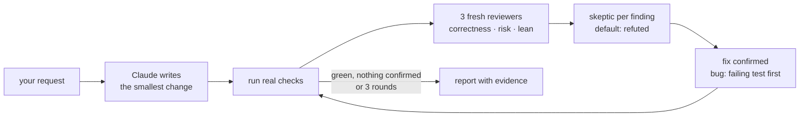

# braid

**Code autopilot for Claude Code.** Install it and keep working as usual. Whenever Claude changes code in a turn, braid runs your project's real checks, gets a fresh-eyes review, tries to refute every finding, fixes what is real (bugs get a failing test first) and repeats until clean, before Claude hands the turn back. You read the result.

[Русская версия](README.ru.md)



Why it is built this way:

- **Checks decide, not the model.** Tests, type checkers, linters and the engines' own compilers are ground truth. "Should work" is not evidence.
- **Fresh eyes.** Reviewers are subagents that never saw how the code was written.
- **Most review findings are wrong.** Every finding goes to a skeptic that tries to disprove it, so noise doesn't turn into needless edits.
- **Bounded.** At most 3 rounds and one loop per turn. Repeated fixes of the same thing stop and get reported as "needs redesign" instead of churning.
- **Lean.** Code is written by the [ponytail](https://github.com/DietrichGebert/ponytail) ladder: skip what isn't needed, reuse, standard library, one line, then the minimum code.

## Install

```
/plugin marketplace add HighVoltSound/braid
/plugin install braid@braid
```

Requires Node.js 18+ on PATH (the hooks and the check runner are Node scripts). Start a new session after installing.

## Works best with Ponytail

[**Ponytail**](https://github.com/DietrichGebert/ponytail) by Dietrich Gebert makes Claude write the smallest code that solves the task, in every session and every subagent. braid is the other half: it proves the code works and fixes what doesn't. Together, Ponytail keeps the code short while it is being written, and braid checks, reviews and repairs it at the end of each turn.

```
/plugin marketplace add DietrichGebert/ponytail
/plugin install ponytail@ponytail
```

braid works without it: when Ponytail is not enabled, braid gives Claude a short version of the same ladder at session start. When Ponytail is enabled, braid stays out of its way and does not repeat it.

## How it works

**Automatic (default).** Nothing to type. At the end of every turn in which Claude changed code, braid's stop hook:

1. Runs the fast checks (types, lint, compile; Godot: headless import and a compile of every script and scene; Unreal: the incremental C++ build; Unity: its C# projects built with `dotnet`). If they fail, Claude may not finish until it fixes them.
2. Then asks Claude, once per turn, to run the braid review loop on exactly the files this turn changed. braid works out the list itself, with or without git. Your own edits between turns never count.
3. Lets Claude skip the loop when its edits only touch comments or formatting, when the changed files are not its own edits, or when it must wait for your answer, if it says so in one line.

**By hand,** any time:

| Command | What it does |
|---|---|
| `/braid:braid add a pause menu` | Builds the task, then runs the loop |
| `/braid:braid` | Loops over your current changes (`git diff HEAD` plus untracked files) |
| `/braid:braid src/cart.js` | Loops over the named files or folder |
| `/braid:braid audit` | Loops over the whole project |

The report lists every check with PASS or FAIL from a fresh run, what was fixed (with `path:line`), the decisions it made instead of asking you, and what no check covers.

**Cost.** One automatic loop is several subagent calls: in testing, 2-4 minutes and about $0.25-2 of usage per turn that changes code (most real turns in testing: $0.60-0.72). For checks only, set `{"gate": "fast"}` in `.claude/braid.json` and run `/braid:braid` yourself when you want the full loop.

The stop hook lets Claude go when the code did not change this turn or matches the last green or reviewed run, when Claude stops again without editing (for example, a failure that was already there), after 3 blocks in one turn, or when the check commands themselves changed during the turn (it never runs new commands unasked). A missing engine (Godot, Unreal, Unity) never blocks, and the hook gives up rather than run past its time limit. It also works when the session is opened in a folder of projects (such as `GODOT_PROJECTS/`), handling each changed project inside.

**Trust:** the hook runs whatever check commands the checkout defines (`npm run lint` and the config it loads, `.claude/braid.json` entries, Godot import, which runs the project's editor plugins; an Unreal build, which runs its `*.Build.cs` files; Unity, which runs its editor scripts; `dotnet build`, which runs Unity's generated `.sln`/`.csproj` and any `Directory.Build.*`). That is the same trust you give a project's `.claude/settings.json` hooks. Use it on code you trust. State is kept per user in `~/.cache/braid`.

## Checks it finds by itself

| Stack | Checks |
|---|---|
| JavaScript / TypeScript | `typecheck`, `lint`, `test`, `build` scripts (npm, pnpm, yarn, bun); `tsc --noEmit` |
| Deno | `deno lint`, `deno check`, `deno test` |
| Python | `ruff`, `mypy`, `pytest` (through `uv run` or `poetry run` when locked) |
| Rust · Go · .NET | `cargo clippy`, `cargo test` · `go vet`, `go test` · `dotnet test` |
| Java / Kotlin · Swift · Dart / Flutter | Gradle or Maven `test` · `swift test` · `analyze`, `test` |
| Elixir · Ruby · PHP · Make | `mix test` · `rspec` or `rake test` · `composer test` or `phpunit` · `make test` |
| Godot 4 | headless import, compile of every script and scene, `tests/*.gd` that `extends SceneTree`, GUT, gdUnit4, `gdlint` |
| Unreal Engine | C++ build with UnrealBuildTool, Automation tests, compile of the project's Blueprints |
| Unity | compile and EditMode/PlayMode tests in batch mode (embedded packages too), the IDE's generated solution built with `dotnet` (fast) |

Anything else: one line in `.claude/braid.json`:

```json
{ "checks": { "test": "ctest --test-dir build", "lint": "clang-tidy src/*.cpp" } }
```

Run them yourself with `node <plugin>/scripts/checks.js [dir] [--list] [--fast]`.

## Godot notes

- Godot 4 projects only (`config_version=5`). For Godot 3, put your checks in `.claude/braid.json`.
- The Godot binary is found by itself: `GODOT_BIN`, PATH, or portable downloads in `Downloads`, `Desktop`, `Documents`, `Program Files`. Among downloads, the build matching the project's `config/features` version wins, and C# projects get a .NET (mono) build. On Windows the `_console.exe` twin is used because it reports exit codes reliably. Or set `"godot": "C:/path/Godot.exe"` in `.claude/braid.json`.
- `--import` writes `*.gd.uid` files next to scripts. That is normal Godot 4.4+ behavior; commit them.
- Folders with a `.gdignore` file are skipped, as Godot does.
- Godot exits 0 on most script errors, so braid reads its output: `SCRIPT ERROR`, parse errors and `ERROR:` lines (including `push_error`) fail a check; shutdown noise does not.
- Warnings set to level 1 are invisible headless. To make braid see them, set the ones you care about to 2 (error) in `project.godot`, e.g. `gdscript/warnings/untyped_declaration=2`.
- Test convention: `tests/<name>_test.gd` that `extends SceneTree`. Assert in `_initialize()` after `await process_frame` (so autoloads exist), `load()` project scripts, reach autoloads with `root.get_node("Name")`, and end with `quit(0)` or `quit(1)`.

## Unreal Engine notes

- The engine is the exact version in the `.uproject`'s `EngineAssociation`: the launcher install (`LauncherInstalled.dat`), a source build (its GUID in the registry or `Install.ini`), or `UE_ROOT` / `"unrealEngine"` in `.claude/braid.json`. **braid never opens a project with another engine version**: the engine itself would do it silently. It reports SKIP instead.
- Checks, in order: `unreal-build` (`Build.bat <Project>Editor Win64 Development`; a no-op build takes about a second, a `.cpp` edit about 10 s, so it runs in the stop hook too), `unreal-tests` (`UnrealEditor-Cmd -ExecCmds="Automation RunTests StartsWith:<Project>"`, about 15 s, after a passing build), `unreal-blueprints` (`-run=CompileAllBlueprints` limited to the project's own assets, about 8 s on a small project).
- An open Unreal Editor with Live Coding (the default) owns the build: the build check reports SKIP and says to press Ctrl+Alt+F11 in the editor. Tests are skipped too, since they would run the old DLL.
- UnrealBuildTool refuses paths of 260+ characters whatever the Windows setting, which leaves about 124 characters for the project folder. Longer paths SKIP with that explanation.
- Blueprint compile runs on every loop; on a project with thousands of Blueprints, add `"skip": ["unreal-blueprints"]` to `.claude/braid.json` if it takes too long. It writes its asset list to `Saved/BraidBPAllow.txt`.
- Compiler messages come in the system language, so braid relies on error codes (`error C2065`, `LNK1104`) and Unreal's own result lines.
- Test convention: `IMPLEMENT_SIMPLE_AUTOMATION_TEST(FNameTest, "Project.Area.Name", EAutomationTestFlags::EditorContext | EAutomationTestFlags::ProductFilter)` in `Source/<Module>/Private/Tests/`.

## Unity notes

- The editor is the exact `m_EditorVersion` from `ProjectSettings/ProjectVersion.txt`, from Unity Hub's install folder or `UNITY_BIN` / `"unity"` in `.claude/braid.json`. **braid never opens a project with another Unity version** (that upgrades it); it reports SKIP instead.
- **Batch mode needs a valid license.** If Unity says "No valid Unity Editor license found", open Unity Hub and sign in: a Personal license expires offline after a while. braid reports SKIP with that hint until then.
- Checks: `unity-tests` / `unity-playmode` when test assemblies exist in `Assets/` or an embedded package (`-runTests`), else `unity-compile` (`-batchmode -quit`). Then `unity-scripts`: the solution your IDE integration generated, built with `dotnet` in a few seconds. It is also the stop hook's compile check, and the only one while the editor has the project open.
- A failure shows the compile errors, each once, or the failed tests with their messages from the results file, instead of Unity's whole log.
- Unity rewrites its generated C# projects only when it refreshes: the editor gets focus, or a batch run compiles the code. While they are behind (scripts added, moved or removed, or an asmdef or package changed since), `unity-scripts` cannot vouch for the code. A passing build and missing-reference errors SKIP, and any other compiler error still fails. A braid run whose Unity check compiles the project brings them up to date. Those `*.csproj` files do not count as code changes.
- Only one Unity can open a project. While the editor has it open, the batch checks SKIP and `unity-scripts` still runs.
- Test convention: an EditMode test assembly in `Assets/Tests/Editor/` (asmdef with `includePlatforms: ["Editor"]`, `defineConstraints: ["UNITY_INCLUDE_TESTS"]`, `precompiledReferences: ["nunit.framework.dll"]`) that references your code's own asmdef.

## SKIP

A check that cannot run for a reason outside the code (an open editor, Live Coding, a license, a missing engine, a path that is too long) reports `SKIP <name>: <what it needs>`. It never blocks Claude and never counts as a pass: the report lists it under "Not checked".

## Settings

| Where | Key | Meaning |
|---|---|---|
| `.claude/braid.json` | `gate` | `auto` (default: fast checks, then the review loop), `fast` (checks only), `all` (all checks including tests, no loop) or `off`. |
| `.claude/braid.json` | `checks` | Map of name to command. Replaces detection. |
| `.claude/braid.json` | `skip` | List of check names not to run, e.g. `["unreal-blueprints"]`. |
| `.claude/braid.json` | `godot` | Path to the Godot binary. |
| `.claude/braid.json` | `unrealEngine` | Engine root folder (the one that holds `Engine/`). |
| `.claude/braid.json` | `unity` | Path to the Unity editor binary. |
| env | `BRAID_GATE` | Overrides `gate` for every project. |
| env | `GODOT_BIN` · `UE_ROOT` · `UNITY_BIN` | Paths to Godot, the Unreal Engine root, the Unity editor. |
| env | `BRAID_TIMEOUT` | Seconds per check, default 600 (120 inside the stop hook). |

## Tested

Before release, `claude -p "/braid:braid audit"` ran on three small projects (JavaScript, Python, Godot 4.7) with planted bugs, dead code and traps: code that looks unused but is called by name or wired to a signal in a `.tscn`. Hidden tests the agent never saw graded the result. On the final run:

| Project | Planted bugs fixed | Traps kept | Dead code removed | Checks |
|---|---|---|---|---|
| JavaScript | 2/2 (+3 real bugs it found on its own) | yes | yes | green |
| Python | 2/2 | yes | kept, as a recorded ruling (public name in an installable package) | green |
| Godot 4.7 | 2/2, each with a failing test first | yes | yes | green |

Each run took 2-4 minutes. In task mode ("add a remove command") it made a one-line change with a test, and it reported an out-of-scope bug instead of touching it. A live session confirmed the stop hook blocks a broken GDScript edit.

The automatic mode was tested with plain requests and no `/braid` typed:

| Request | What happened | Usage |
|---|---|---|
| "Add `cheapest(items)` and a CLI command" (JavaScript) | the stop hook asked for the loop on the 3 changed files; 3 reviewers, nothing to fix | $0.60 |
| "Add `heaviest(items)`" (Godot 4.7) | same, with a new test and green Godot checks | $0.62 |
| "Change the docstring" (Python) | the hook asked; Claude skipped the loop as a comments-only change | $0.25 |

Unreal Engine 5.8 and Unity 6 (6000.3) support was run against the real engines on small test projects:

| Engine | Case | Result |
|---|---|---|
| Unreal 5.8 | clean project | `unreal-build`, `unreal-tests`, `unreal-blueprints` PASS (first build 91 s, then seconds) |
| Unreal 5.8 | compile error / failing Automation test | build FAIL with the error, tests and Blueprints SKIP / tests FAIL with the failed expectation |
| Unreal 5.8 | editor open with Live Coding | build SKIP with the Ctrl+Alt+F11 hint |
| Unity 6 | clean project | EditMode, PlayMode and `unity-scripts` PASS in about 10 s; the stop hook's `dotnet` build takes about 1 s |
| Unity 6 | compile error, failing EditMode or PlayMode test | FAIL with each compile error once, or the test's name, message and file:line |
| Unity 6 | tests only in an embedded package; project open in another Unity | found and run; batch checks SKIP while `unity-scripts` still compiles |
| Unity 6 | scripts or asmdefs added, moved, deleted, renamed or copied in; `csc.rsp` or package changes; `Library` missing | `unity-scripts` SKIPs (never a false PASS) until Unity regenerates its projects, and real compile errors still FAIL |

The Unity design went through four rounds of live runs (about 20 scenarios) and three review rounds before release.

## Limits

braid can only be as sure as your checks. It writes a test for every bug it fixes, so coverage grows with each run, but it cannot see what nothing measures: how a game feels, visuals, performance on a real device. It says so in every report.

The stop hook tells changes apart by time, not by author. Files you edit while Claude is working (or that another session or an editor autosave writes) show up in that turn's list; Claude is told to leave edits that are not its own. Two sessions working in one project share the "reviewed" mark.

## Credits

- Build ladder adapted from [ponytail](https://github.com/DietrichGebert/ponytail) by Dietrich Gebert (MIT).
- Verification-before-completion and test-first fixing ideas from [superpowers](https://github.com/obra/superpowers) (MIT).
- Refuting each finding before acting on it follows Anthropic's [code-review plugin](https://github.com/anthropics/claude-code/tree/main/plugins/code-review) and [Claude Code best practices](https://code.claude.com/docs/en/best-practices).

## Development

```
npm test
```

Runs the unit tests and, when a Godot binary is found, integration tests against real generated Godot projects.

MIT License.
